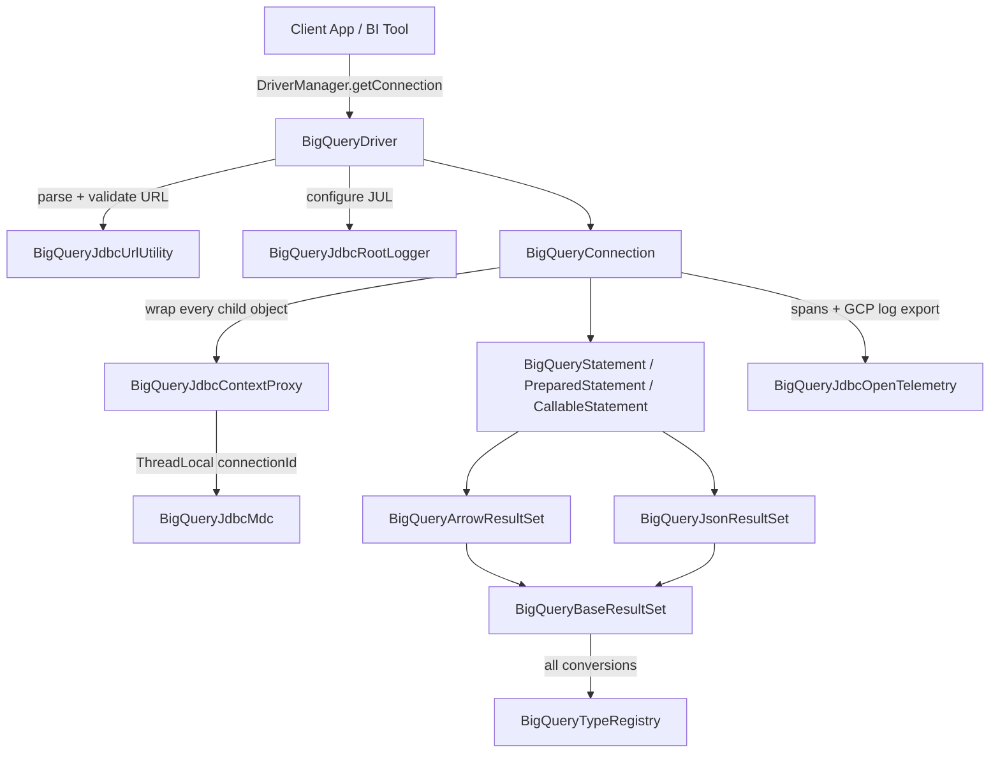

# BigQuery JDBC Driver Development

Module root: [java-bigquery-jdbc](file:///usr/local/google/home/neenushaji/IdeaProjects/google-cloud-java/java-bigquery-jdbc)
Maven artifact: `google-cloud-bigquery-jdbc`. Packages: `com.google.cloud.bigquery.jdbc` (driver)
and `com.google.cloud.bigquery.exception` (exceptions).

This is a **handwritten, split-repo** module. Nothing here is generated — edit source directly.

> [!IMPORTANT]
> [DEVELOPMENT.md](file:///usr/local/google/home/neenushaji/IdeaProjects/google-cloud-java/java-bigquery-jdbc/DEVELOPMENT.md)
> has drifted in places (it references `BigQueryJdbcTypeMappings` and `BigQueryCoercion`, which
> do not exist). The class names in this skill reflect the current source. When in doubt, grep
> the source rather than trusting either document.

---

## 1. Component Map



### Key classes

| Class | Role |
| :--- | :--- |
| [BigQueryDriver](file:///usr/local/google/home/neenushaji/IdeaProjects/google-cloud-java/java-bigquery-jdbc/src/main/java/com/google/cloud/bigquery/jdbc/BigQueryDriver.java) | `java.sql.Driver` entry point for `jdbc:bigquery://` URLs. |
| [BigQueryConnection](file:///usr/local/google/home/neenushaji/IdeaProjects/google-cloud-java/java-bigquery-jdbc/src/main/java/com/google/cloud/bigquery/jdbc/BigQueryConnection.java) | Session state, dataset defaults, BigQuery client, tracer, connection ID. |
| [BigQueryJdbcUrlUtility](file:///usr/local/google/home/neenushaji/IdeaProjects/google-cloud-java/java-bigquery-jdbc/src/main/java/com/google/cloud/bigquery/jdbc/BigQueryJdbcUrlUtility.java) | Property-name constants, `VALID_PROPERTIES`, URL parsing with an LRU parse cache. |
| [BigQueryJdbcContextProxy](file:///usr/local/google/home/neenushaji/IdeaProjects/google-cloud-java/java-bigquery-jdbc/src/main/java/com/google/cloud/bigquery/jdbc/BigQueryJdbcContextProxy.java) | Dynamic proxy: MDC scoping, `++entry++`/`++exit++` tracing, single-point exception logging, cascading re-wrap of child objects. |
| [BigQueryTypeRegistry](file:///usr/local/google/home/neenushaji/IdeaProjects/google-cloud-java/java-bigquery-jdbc/src/main/java/com/google/cloud/bigquery/jdbc/BigQueryTypeRegistry.java) | **The** conversion entry point: `convert(value, targetClass)` and `convert(value, bqType, targetClass, zone)`. |
| [BigQueryTemporalUtility](file:///usr/local/google/home/neenushaji/IdeaProjects/google-cloud-java/java-bigquery-jdbc/src/main/java/com/google/cloud/bigquery/jdbc/BigQueryTemporalUtility.java) | Date/Time/Timestamp/interval parsing and zone handling. |
| [BigQueryBaseResultSet](file:///usr/local/google/home/neenushaji/IdeaProjects/google-cloud-java/java-bigquery-jdbc/src/main/java/com/google/cloud/bigquery/jdbc/BigQueryBaseResultSet.java) | Shared getter logic for both Arrow and JSON result sets. |
| [BigQueryJdbcOpenTelemetry](file:///usr/local/google/home/neenushaji/IdeaProjects/google-cloud-java/java-bigquery-jdbc/src/main/java/com/google/cloud/bigquery/jdbc/BigQueryJdbcOpenTelemetry.java) | SDK caching/ref-counting, span helper `withTracing(...)`, GCP log export. |

---

## 2. Guardrails

1. **Most restrictive visibility.** Many core classes are package-private (`class BigQueryJdbcContextProxy`). Only widen when a `java.sql` interface forces it. Prefer `@InternalApi` over bare `public`.
2. **Explicit imports only.** No wildcard imports, no inline fully-qualified names.
3. **Never use `java.util.logging.Logger` directly** in driver code — use `BigQueryJdbcCustomLogger` (see §4).
4. **Throw from `com.google.cloud.bigquery.exception`**, not bare `SQLException`, at public boundaries. Pick the specific subclass:
   - `BigQueryJdbcException` — general checked JDBC error; has a `(String, BigQueryException)` ctor that formats the BQ error.
   - `BigQueryJdbcSqlSyntaxErrorException` — malformed SQL.
   - `BigQueryJdbcSqlFeatureNotSupportedException` — unsupported JDBC feature.
   - `BigQueryConversionException` / `BigQueryJdbcCoercionException` / `BigQueryJdbcCoercionNotFoundException` — type coercion failures.
   - `BigQueryJdbcRuntimeException` — unchecked, for paths that cannot declare `throws`.
5. **Do not mock final JDK types** (`BigDecimal`, `LocalDate`, `Instant`, `UUID`, `String`) with Mockito. Construct real instances. `mockito-inline` is on the classpath, but mocking final JDK classes is unstable on JDK 21+.
6. **Do not add external dependencies.** Prefer the JDK, then existing deps. Do not bump versions except for CVEs.
7. **Never break the public JDBC surface** without following [api-lifecycle](file:///usr/local/google/home/neenushaji/IdeaProjects/google-cloud-java/.agents/skills/api-lifecycle/SKILL.md) (`@ObsoleteApi` before `@Deprecated`).
8. Always follow java coding best practices. tott rules and module coding conventions.
9. Use blocks even for single statement if and loops.
10. Prefer early return.
11. Avoid unnecessary null checks. Always confirm there is a real possibility of a null value before adding the check. (This is about defensive checks — it does not relax the JDBC SQL-NULL handling required in §6.)
12. **Ignore the OAuth p12 test failure** — do not change driver code to chase it. Note that `ITAuthTests#testValidServiceAccountAuthenticationP12` is already `@Disabled` and needs `SA_SECRET_P12`, so a p12 failure is most likely `BigQueryJdbcOAuthUtilityTest#testPrivateKeyFromP12Bytes` or `#testPrivateKeyFromP12Bytes_wrong_password`, which load the `/fake.p12` test resource.
13. When adding or suggesting code, always include logs for debuggability — following the §4 conventions. "More logs" never means hand-written `++enter++`/`++exit++` on proxied methods or logging an exception that the proxy already logs.
14. When ever the code is changed, be performance aware and JDBC compliant. If a code is likely to affect either, notify me.
15. When writing code, always make sure real life use cases are considered and edge cases are dealt with.
16. **Never use jargon without explanation.** In code comments, docs, commit messages, and answers to me, define a term the first time it appears — spell out acronyms and say what the concept means in plain words. Write "safe publication (the guarantee that a thread seeing the object also sees its initialized fields)", not "safe publication". This applies to domain jargon (Clearcut, MDC, substrate) as well as Java/concurrency jargon.
17. **Confirm a failure is real before guarding against it, and keep fields `final`.** Do not add a `try`/`catch` around a helper that already handles its own failures, and do not make a field mutable or lazily initialized without a measured reason. See §8.

---

## 3. Build & Test

All tasks go through the module [Makefile](file:///usr/local/google/home/neenushaji/IdeaProjects/google-cloud-java/java-bigquery-jdbc/Makefile). Run from the module directory.

```bash
make install        # build + install into the local repo (delegates to .kokoro/common.sh)
make clean
make lint           # spotify fmt-maven-plugin:format — ALWAYS run before finishing
```

### Resolving the module after upstream snapshot bumps

The module inherits versions from `google-cloud-jar-parent`, which imports
`google-cloud-shared-dependencies` and, through it, the `sdk-platform-java` snapshots (gax,
java-core, auth, common-protos, ...). When the monorepo bumps those `-SNAPSHOT` versions, nothing in
`~/.m2` matches any more and every `mvn` / `make` invocation in this module fails during POM
resolution with errors like:

```
Non-resolvable import POM: com.google.cloud:google-cloud-shared-dependencies:pom:<x>-SNAPSHOT
'dependencies.dependency.version' for com.google.api:gax:jar is missing
```

Do **not** fix this by building the whole monorepo or by hand-picking `-pl` / `-am` module lists.
Run the Kokoro helper from the **monorepo root** — it installs only the upstream modules the JDBC
driver needs, with tests and javadoc skipped:

```bash
cd /usr/local/google/home/neenushaji/IdeaProjects/google-cloud-java
source .kokoro/common.sh && install_modules java-bigquery-jdbc
```

Then return to `java-bigquery-jdbc/` and re-run the original `make` target. This step needs network
access (it may pull new third-party versions), so run it outside the sandbox.

### Unit tests (surefire, JUnit 5)

```bash
make unittest                                          # all
make unittest test=BigQueryStatementTest               # one class
make unittest test=BigQueryStatementTest#testExecute   # one method
make unittest excludedGroups="known_issues"            # skip tagged tests
```

### Integration tests (failsafe, real GCP)

> [!WARNING]
> ITs hit live BigQuery and cost money. Never run the full IT suite speculatively — always scope
> with `test=`. They require `GOOGLE_APPLICATION_CREDENTIALS`; some also need `KMS_RESOURCE_PATH`,
> `SA_EMAIL`, or (for TPC) `ENDPOINT_URL` / `UNIVERSE_DOMAIN` / `PROJECT_ID`.

```bash
export GOOGLE_APPLICATION_CREDENTIALS=/usr/local/google/home/neenushaji/Documents/gcp-keys/bq-devtools.json
export GOOGLE_CLOUD_PROJECT=bigquery-devtools-drivers
export SA_SECRET=/usr/local/google/home/neenushaji/Documents/gcp-keys/bq-devtools.json
make integration-test test=ITStatementTest#testBatchExecute
```

Defaults: `skipSurefire=true`, `skipShade=true`, and `-Dit.failIfNoSpecifiedTests=true` — a typo in
`test=` fails the build rather than silently passing.

### Coverage and Docker

```bash
make unit-test-coverage      # jacoco report -> jacoco-unittests.zip
make full-coverage           # ITs + unit tests -> jacoco-full.zip (expensive)
make docker-session          # interactive shell if no local JDK/Maven
make docker-unittest test=BigQueryConnectionTest
```

---

## 4. Logging

Two loggers, chosen by call-site frequency:

- **`BigQueryJdbcCustomLogger`** — general driver code.
- **`BigQueryJdbcResultSetLogger`** — result-set hot paths only. Use `LOG.finestTrace("getInt")`; it is allocation-free when the level is disabled.

### Instantiation

```java
// Instance components (Connection, Statement, DatabaseMetaData) — include instance identity
private final BigQueryJdbcCustomLogger LOG = new BigQueryJdbcCustomLogger(this.toString());

// Static / utility components — use the class name
private static final BigQueryJdbcCustomLogger LOG =
    new BigQueryJdbcCustomLogger(BigQueryTypeRegistry.class.getName());
```

### Rules

1. **Never concatenate.** The logger takes printf-style varargs or a `Supplier<String>`, both of
   which skip work when the level is disabled.
   ```java
   LOG.fine("Executing on dataset: %s, table: %s", datasetId, tableId);   // good
   LOG.fine(() -> "Parsed: " + expensive.toDebugString());                // good for expensive work
   LOG.fine("Executing on dataset: " + datasetId);                        // BAD — always allocates
   ```
2. **Do not hand-write `++enter++`/`++exit++`** on proxied methods. `BigQueryJdbcContextProxy` already
   emits `++entry++`/`++exit++` at `FINER` for every method reached through the proxy. Add manual
   tracing only for internal routines the proxy never sees.
3. **Do not log-and-rethrow.** The proxy is the unified exception logger and records each exception
   exactly once with connection context. Logging again produces duplicates.
4. **Preserve MDC across threads.** Anything running off the calling thread (daemon pollers,
   executors) must re-establish context:
   ```java
   try (BigQueryJdbcMdc.MdcCloseable mdc = BigQueryJdbcMdc.registerInstance(connectionId)) {
     // ...
   }
   ```

---

## 5. OpenTelemetry

Spans are created through the helper, never by hand:

```java
return BigQueryJdbcOpenTelemetry.withTracing("BigQueryStatement.executeQuery", connection, sql,
    () -> { /* work */ });
```

`withTracing` sets `db.system`, `db.connection_id`, `db.application`, and `db.statement`, puts the
connection ID into OTel Baggage, records exceptions, sets `StatusCode.ERROR`, and always ends the
span. Use the `DB_*` constants on `BigQueryJdbcOpenTelemetry` for any extra attributes — do not
invent attribute keys.

Lifecycle rules:
- SDKs are cached and **ref-counted** by `SdkCacheKey`. A connection that obtains one via
  `getOpenTelemetry(...)` must call `releaseSdk(...)` on close, and `registerConnection(...)` /
  `unregisterConnection(...)` must be symmetric — otherwise the SDK and Logging client leak.
- **Telemetry failures must never break JDBC.** Catch, log at `warning`, and continue.

> [!TIP]
> Unit tests that touch instrumented code paths need a stubbed `Tracer`, or
> `BigQueryJdbcOpenTelemetry` will NPE. Use
> [OpenTelemetryTestUtility](file:///usr/local/google/home/neenushaji/IdeaProjects/google-cloud-java/java-bigquery-jdbc/src/test/java/com/google/cloud/bigquery/jdbc/OpenTelemetryTestUtility.java).

---

## 6. JDBC Compliance

### Null handling

Distinguish **SQL NULL** (legal, returns a default) from **invalid coercion** (throws).

- Validate impossible type conversions **up front**, before fetching, using the column's
  `StandardSQLTypeName` — e.g. `getTimestamp` on an `INT64` column throws immediately.
- Primitive getters return the JDBC default on NULL; object getters return `null`:
  ```java
  Integer result = BigQueryTypeRegistry.convert(value, Integer.class);
  return result != null ? result : 0;     // getInt -> 0, getLong -> 0L, getDouble -> 0.0d
  ```
  `getBoolean` returns `false`; `getString`/`getDate`/`getBigDecimal`/`getBytes` return `null`.
- Call `setWasNull(value)` so `wasNull()` is accurate — BI tools rely on it.
- Wrap coercion failures with `createCoercionException(columnIndex, TargetType.class, cause)`.

### Other invariants

- **Every getter and state-mutating method starts with `checkClosed()`.**
- **All conversion goes through `BigQueryTypeRegistry`.** Do not add ad-hoc casts or parsing in
  result sets, statements, or metadata — add the mapping to the registry instead.
- **Wrap objects returned from public entry points** with `BigQueryJdbcContextProxy.wrap(obj, Iface.class, connectionId)`.
  `ResultSet` is deliberately **not** proxied (JIT inlining on the hot iteration path) — keep it that way.
- Result sets are `TYPE_FORWARD_ONLY` + `CONCUR_READ_ONLY`. Unsupported operations throw
  `BigQueryJdbcSqlFeatureNotSupportedException`; harmless no-ops (e.g. `setFetchSize`) should be
  accepted so BI tools don't crash.
- Adding a connection property means updating **both** the constant and `VALID_PROPERTIES` in
  `BigQueryJdbcUrlUtility`, plus `DataSource` and `getPropertyInfo` if user-visible.
- `SAFE_TO_LOG_PROPERTIES` lives in **`BigQueryConnection`**, not `BigQueryJdbcUrlUtility`. It is an
  **allowlist**: at `CONFIG` level the connection logs every property, masking as `*****` anything
  absent from the set. Omitting a new property is therefore the safe default — only add it if the
  value can never carry a secret. Adding a credential-bearing property leaks it into the logs.

---

## 7. Testing Conventions

JUnit 5 (`org.junit.jupiter.*`) + Mockito. **Never** import `org.junit.Test` (JUnit 4).

- Unit tests: `src/test/java/com/google/cloud/bigquery/jdbc/*Test.java`
- Integration tests: `.../jdbc/it/IT*.java`, extending
  [ITBase](file:///usr/local/google/home/neenushaji/IdeaProjects/google-cloud-java/java-bigquery-jdbc/src/test/java/com/google/cloud/bigquery/jdbc/it/ITBase.java)
- Shared helpers: `.../jdbc/utils/` (`TestUtilities`, `URIBuilder`, `ArrowUtilities`)

Extend [BigQueryJdbcBaseTest](file:///usr/local/google/home/neenushaji/IdeaProjects/google-cloud-java/java-bigquery-jdbc/src/test/java/com/google/cloud/bigquery/jdbc/BigQueryJdbcBaseTest.java)
for connection-URL tests and build URLs with its helpers rather than string literals:

```java
String url = getUriOAuthServiceAccount().append("ProjectId", "my-project").toString();
```

It also exposes `fake_pkcs8_key`, a throwaway key for auth tests — never add a real credential.

**Tags** (`@Tag`), excluded via `excludedGroups=`:

| Tag | Meaning |
| :--- | :--- |
| `disable_tpc` | Cannot run against Trusted Partner Cloud universes. |
| `advanced` | Needs elevated permissions or extra setup. |
| `known_issues` | Known-failing; excluded in CI. |

Other expectations:
- Use `@ParameterizedTest` + `@MethodSource`/`@CsvSource`/`@ValueSource` for coercion matrices.
- No `UnnecessaryStubbingException` warnings — remove stubs the test doesn't use.
- Prefer `Assertions.assertThrows` and assert on the **specific** exception subclass.
- Every new branch needs a test; every bug fix needs a regression test.

---

## 8. Defensive Code & Concurrency

### 8.1 Don't duplicate a guarantee the callee already makes

Some helpers are deliberately **total** — meaning they always return a value and never throw,
falling back to something harmless (`"unknown"`, a random UUID, an empty list) instead of failing.
Wrapping a total helper in `try`/`catch` at the call site adds no safety. It copies the guarantee to
a second place where no test covers it, and obscures the fact that the callee is meant to be total.

Before adding a guard, trace every leaf call and ask whether it can actually throw. If you find a
real hole, **fix it in the callee**, so every caller benefits and the contract stays in one tested
place.

Worked example:
[DriverEnvironmentBuilder.build()](file:///usr/local/google/home/neenushaji/IdeaProjects/google-cloud-java/java-bigquery-jdbc/src/main/java/com/google/cloud/bigquery/jdbc/telemetry/v1/DriverEnvironmentBuilder.java#L42-L56)
catches `SecurityException` around each system-property read and degrades to `"restricted"` /
`"unknown"`, and wraps telemetry-tag file I/O in `catch (Exception)` / `catch (IOException)`. It is
total by construction, so a `catch (Throwable)` wrapper at the call site is dead code. The single
real gap was `Paths.get(userHome, ...)`, which throws `InvalidPathException` — an unchecked
`IllegalArgumentException` that the method's `catch (SecurityException)` does not cover. That fix
belongs in the builder, not at the call site.

This is guardrail 11 (avoid unnecessary null checks) applied to exceptions: confirm the failure is
possible before writing code to handle it.

### 8.2 Know whether your caller swallows or rethrows

"Telemetry must never break JDBC" holds only if something actually stops the exception.
[BigQueryDriver.connect](file:///usr/local/google/home/neenushaji/IdeaProjects/google-cloud-java/java-bigquery-jdbc/src/main/java/com/google/cloud/bigquery/jdbc/BigQueryDriver.java#L232-L235)
ends in `catch (Throwable t) { recordConnectionAttempt(...); throw t; }` — it records and
**rethrows**. Anything that throws on the connect path therefore fails the user's
`getConnection()`. Worse, `TelemetryManager.getInstance` publishes its singleton only after
successful construction, so a throw there repeats on every subsequent connect for the life of the
JVM.

`TelemetryManager.runSafely` is the seam that genuinely contains telemetry failures (it catches
`Throwable`). A bare call is not. Check the enclosing handler before assuming a failure is contained.

### 8.3 Prefer `final` over lazy initialization

Keep fields `final` and assign them in the constructor unless there is a measured reason not to.

This is not style. The Java Memory Model — the rules that say when one thread is guaranteed to see
another thread's writes — gives final fields **safe publication**: once the constructor finishes,
any thread that can see the object is guaranteed to see its correctly initialized final fields, with
no synchronization required. Remove `final` and that guarantee downgrades to a convention a future
edit can silently break, producing a **data race** — two threads accessing the same field with no
ordering between them, where one can read a stale or half-written value.

Costs of going lazy that are easy to overlook:

| Cost | Why it bites |
| :--- | :--- |
| Lost compiler-checked invariant | "Assigned once, always visible" stops being enforced by `javac` and becomes a comment. |
| `null` gains two meanings | It now means "not resolved yet" *or* "legitimately absent", so you need a second `resolved` flag — otherwise the absent case retries the expensive work on every pass, forever. |
| Behavior change | Work happens on first use rather than at construction, so the first operation can observe a half-configured object. |

Performance is usually **not** the deciding cost, so don't justify laziness with it. On x86-64 a
`volatile` read — a read the JVM may not reorder or cache in a CPU register — compiles to the same
instruction as an ordinary read; only the write needs a barrier. `TelemetryBatcher.driverEnvironment`
is read once per flush, that is once per `DEFAULT_TELEMETRY_UPLOAD_INTERVAL_VALUE` (5 minutes).
Optimizing that read is meaningless.

### 8.4 If a field must be mutable, reuse the existing lock

Don't reach for `volatile` reflexively. If every read and write already happens inside one lock, the
lock supplies the visibility and a plain field is correct — `ReentrantLock` establishes the same
ordering guarantee as `synchronized`. Mark it `@GuardedBy("lockName")`
(`javax.annotation.concurrent.GuardedBy`, already used in
[BigQueryJdbcBulkInsertWriter](file:///usr/local/google/home/neenushaji/IdeaProjects/google-cloud-java/java-bigquery-jdbc/src/main/java/com/google/cloud/bigquery/jdbc/BigQueryJdbcBulkInsertWriter.java#L46))
so the requirement is documented rather than assumed.

Add `volatile` only when a field is genuinely read outside the lock.

### 8.5 Put one-time work where it runs once

`TelemetryConfiguration.Builder.resolveProperties` runs on **every** `getConnection()` — it is
called merely to read the telemetry opt-out flag. Per-JVM setup such as filesystem reads or
environment detection belongs in the singleton-creation block of `TelemetryManager.getInstance`,
which runs once. Placing it in `resolveProperties` would add a file access to every connection.

Before adding work to a method, check how often it is actually called.

---

## 9. Pre-PR Checklist

- [ ] `make lint` run and clean.
- [ ] `make unittest` passes, with no unnecessary-stubbing warnings.
- [ ] Narrowest possible visibility; no wildcard imports or inline FQNs.
- [ ] Exceptions come from `com.google.cloud.bigquery.exception` and are the specific subclass.
- [ ] No defensive `try`/`catch` or null check added without confirming the failure is possible; fields left `final` unless there is a stated reason (§8).
- [ ] Logging uses the custom loggers with format args or suppliers — no concatenation, no duplicate exception logging.
- [ ] `checkClosed()` at the top of new getters/mutators; `setWasNull(...)` where relevant.
- [ ] New conversions live in `BigQueryTypeRegistry`; new properties registered in `VALID_PROPERTIES` (`BigQueryJdbcUrlUtility`) and, **only if the value is never sensitive**, in `SAFE_TO_LOG_PROPERTIES` (`BigQueryConnection`).
- [ ] Objects returned from public entry points are proxy-wrapped (except `ResultSet`).
- [ ] OTel SDK acquire/release and connection register/unregister are symmetric.
- [ ] Public API changes follow [api-lifecycle](file:///usr/local/google/home/neenushaji/IdeaProjects/google-cloud-java/.agents/skills/api-lifecycle/SKILL.md).
- [ ] Conventional commit: `feat(bigquery-jdbc): ...` / `fix(bigquery-jdbc): ...`.
- [ ] Consider whether the change must be mirrored to the split repo.
