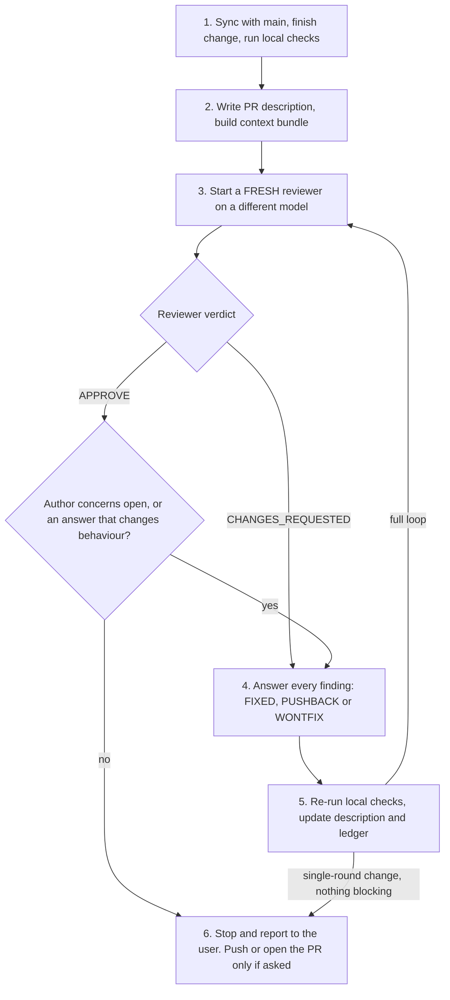

# Preparing a PR with external review

When you (the **author agent**) finish a change, you aren't done when your own
tests pass. Get an independent review from an agent running a **different
model** first, and repeat until you and the reviewer agree the PR is ready.

This skill never pushes or opens a PR by itself. Do that only if the user asked.



## How much review the change needs

| The change | Review |
| --- | --- |
| Edits any `.java` file under `src/`, beyond comments or formatting | **Full loop**: steps 1 to 6. |
| Anything else: docs, Markdown, skills, build or CI config, dependency bumps, comment-only or formatting-only edits | **Single round**: steps 1 to 4 once, then re-run the checks, update the description, and report as in step 6. Go one more round only if the reviewer raised a `blocking` finding, to confirm the fix. |

If you aren't sure which row applies, use the full loop. In a single-round
change, run only the local checks the change can affect.

## 1. Sync with main, finish the change, run local checks

Before you ask anyone to review, the branch must be current and the change must
build and pass its tests:

- Sync: `git fetch origin main`, then bring `origin/main` into the branch. If
  the branch is already pushed, merge instead of rebasing unless the user asks
  for a rebase, so nobody has to force-push. (`origin` here means the remote for
  `googleapis/google-cloud-java`.)
- Format: `make lint` from `java-bigquery-jdbc/`. It rewrites files in place.
- Unit tests: the full suite, `make unittest`, before the first round and again
  on the final code. Between rounds the classes you touched are enough:
  `make unittest test=<TestClass>`.
- Integration tests compile at least: `mvn -q -Denforcer.skip=true -Dclirr.skip=true test-compile`.
- Follow the repo and module `AGENTS.md` and, for test changes, the
  `bigquery-jdbc-testing` skill.

## 2. Write the PR description and build the context bundle

Write the PR description now, not after the review. The reviewer checks it too.
It has:

- **Title** in Conventional Commits form: `fix(bigquery-jdbc): ...`.
- **What** changed and **why** (the bug, the issue link, or the requirement).
- **How it was tested**: the commands you ran, new tests, and anything you
  couldn't run (for example integration tests that need credentials).
- **Risks / follow-ups**, if any.

**Untracked files are in no diff.** Before you build the bundle, run
`git status --short`. For every `??` file that belongs to the change, run
`git add -N <file>` (or commit it) so the reviewer sees it.

Build a **context bundle** for the reviewer:

1. The PR description, word for word.
2. The full diff from the merge base to your working tree:
   `git diff "$(git merge-base origin/main HEAD)"`. One diff covers committed,
   staged and unstaged changes.
3. The list of changed files (the same command with `--name-only`) and the repo
   path, so the reviewer can open surrounding code itself.
4. From round 2 on, the **review ledger** (see step 4).

Keep the bundle and ledger in a scratch location **outside the repository** (for
example the agent's scratch or artifact directory, or `/tmp`). Never commit them.

## 3. Start a fresh reviewer on a different model

The reviewer must run on a **different model from yours**, so its blind spots
differ from yours. Prefer a model at least as capable as your own. If every
different model you can reach is weaker than yours, use the strongest of them
and say so in the final report, so the user knows how much weight the approval
carries.

Start a **new** reviewer every round. Don't continue an old reviewer
conversation, because it is already anchored on its earlier opinions. The ledger
gives the new reviewer the history it needs.

Save the filled-in prompt as a file in the scratch location (`$PROMPT_FILE`
below). How to start a reviewer, depending on your harness:

| Harness | How to start a different-model reviewer |
| --- | --- |
| Antigravity (IDE / App) | `invoke_subagent` with a `Model` other than your own, on a read-only type such as `research`. Give it the path of the prompt file, or the prompt itself if it is short. |
| Antigravity CLI (`agy`) or terminal-based agents | Antigravity CLI from the shell: `agy --sandbox --model "<model>" -p "Review as instructed on stdin. Do not modify any files." < "$PROMPT_FILE"` (`--sandbox` isolates shell execution; run `agy models` to list available model slugs and pick one different from your own). If `agy` isn't installed, use a read-only subagent in your harness pinned to a different model. |

- Pass the prompt on stdin as shown, not as a command-line argument. Linux
  limits a single argument to 128 KiB, and a large diff plus this template
  exceeds that.
- Choose a model and service permitted by your repository or organization policy;
  do not send unpublished or restricted changes to disallowed third-party models
  or external services.
- If you can't get a different model at all, stop and tell the user. Don't
  quietly use your own model to review your own work. If you can't tell which
  model you are running on, say that in the final report.

### Reviewer prompt template

```text
You are an independent senior reviewer for a pull request to the google-cloud-java
monorepo, module java-bigquery-jdbc (the BigQuery JDBC driver). You did not write
this code. Be rigorous and specific, and don't rubber-stamp it.

Repository: <absolute repo path>  (you may read any file for context)
Base branch: origin/main
Round: <n>

== PR DESCRIPTION ==
<description>

== CHANGED FILES ==
<file list>

== DIFF ==
<diff>

== REVIEW LEDGER FROM EARLIER ROUNDS (empty in round 1) ==
<ledger>

Review for: correctness and edge cases, concurrency and resource leaks
(connections, statements, result sets, threads), JDBC spec compliance, backward
compatibility and public API surface (see AGENTS.md and the api-lifecycle skill),
security (credentials, logging of secrets), test coverage of every new branch,
test quality (see the bigquery-jdbc-testing skill), and whether the PR
description is accurate and complete. For documentation, skill and config
changes, check every factual claim (class names, commands, paths) against the
repository.

From round 2 on:
- For each finding marked FIXED, check the fix in the code. Don't repeat the
  finding unless the fix is wrong or incomplete.
- For each finding marked PUSHBACK, say whether you ACCEPT the author's reason
  (the finding is then closed) or MAINTAIN it, with a new argument.
- Findings marked WONTFIX are closed nits. Don't repeat them.
- Concentrate on what the ledger says changed since the previous round. Raise a
  new finding on code that has not changed since then only if it is blocking or
  major.

Reply in exactly this format:

VERDICT: APPROVE | CHANGES_REQUESTED
FINDINGS:
- id: R<round>-<n>
  severity: blocking | major | minor | nit
  location: <file>:<line> | PR description
  issue: <what is wrong and why it matters>
  suggestion: <concrete fix>
PUSHBACK_RESPONSES:
- id: <earlier finding id>
  decision: ACCEPT | MAINTAIN
  reason: <why>

APPROVE only if no blocking or major findings are open.
```

## 4. Answer every finding

Answer **every** finding in the ledger with exactly one of:

- **FIXED**: say what you changed and where (file and lines). The next reviewer
  uses this to find the change.
- **PUSHBACK**: you disagree. You **must** give a concrete reason backed by
  evidence: a code reference, the JDBC spec, an existing convention in the repo,
  a test result, or scope ("out of scope for this PR; tracked in <issue>").
  "I prefer it this way" is not a reason.
- **WONTFIX**: for `nit` findings only, with a short reason. It closes the
  finding.

Rules:

- Take the findings seriously. Push back only when you are confident the
  reviewer is wrong or the request is out of scope. Don't push back to save
  effort.
- If the reviewer maintains a pushback, you may answer it once more. If it is
  maintained a second time, fix it, or stop and escalate to the user (see
  step 6). Don't argue a third round.
- You may also add your **own** open concerns to the ledger, things you are
  still unsure about. The loop doesn't end while any of them are open.
- An `APPROVE` can still carry `minor` or `nit` findings. Answer them like any
  others. If an answer changes behaviour (anything beyond renames, comments,
  formatting, or the PR description), that code has not been reviewed: go
  another round. Otherwise re-run the checks and finish.

### Ledger format

Keep one ledger file for the whole loop and append to it every round:

```markdown
## Round <n>, reviewer model: <model>, verdict: <APPROVE|CHANGES_REQUESTED>

| id | severity | finding | author response | status |
| --- | --- | --- | --- | --- |
| R1-1 | blocking | ResultSet leaked on error path in Foo.java:120 | FIXED: try-with-resources in Foo.java:118-131 | closed |
| R1-2 | major | Missing test for default universe | FIXED: added testXForDefaultUniverse in FooTest.java:210-240 | closed |
| R1-3 | minor | Rename helper to assertY | PUSHBACK: name matches existing assertX convention in BarTest | open, awaiting reviewer |
| R1-4 | nit | Blank line before return | WONTFIX: formatter output | closed |

Author open concerns: <none | list>
```

## 5. Re-run checks and loop

After you address the findings:

1. Re-run the local checks from step 1. Every round, not just the first.
2. Update the PR description if the change or the testing changed.
3. Rebuild the context bundle (new diff, updated ledger).
4. Go back to step 3 with a **new** reviewer.

A single-round change stops after item 2, unless the reviewer raised a
`blocking` finding.

## 6. When to stop

The full loop **ends successfully** only when all of these are true:

- The latest reviewer's verdict is `APPROVE`.
- No `blocking` or `major` finding is open, and every pushback is either
  ACCEPTED or resolved by a fix.
- You (the author) have no open concerns.
- Nothing that changes behaviour was edited after the last review.
- The local checks, including the full unit suite, pass on the final code.

**Safety limit:** stop after **5 rounds** without agreement, or when a pushback
has been maintained twice and you are not going to fix it. Report the
unresolved items to the user with both sides' arguments and let them decide.
Don't loop forever, and don't declare agreement that didn't happen.

When you stop, report to the user: the number of rounds, the reviewer model(s)
used and whether any was weaker than yours, what changed because of review, any
accepted pushbacks, anything you changed after the last review, any finding
left unfixed, and the final PR description. Push or open the PR only if the
user asked you to.
