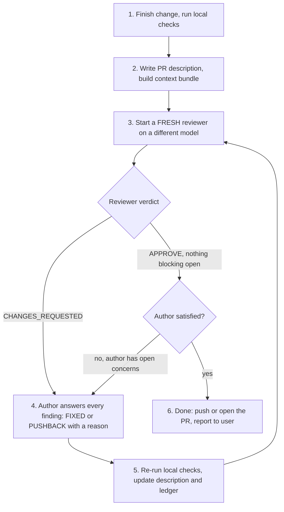

# Preparing a PR with external review

When you (the **author agent**) finish a change, you aren't done when your own
tests pass. Get an independent review from an agent running a **different
model** first, and repeat until you and the reviewer agree the PR is ready.



## 1. Finish the change and run local checks

Before you ask anyone to review, the change must build and pass its tests:

- Format: `make lint` from `java-bigquery-jdbc/`.
- Unit tests for the classes you touched: `make unittest test=<TestClass>`.
- Integration tests compile at least: `mvn -q -Denforcer.skip=true -Dclirr.skip=true test-compile`.
- Follow the repo `AGENTS.md` and, for test changes, the `bigquery-jdbc-testing` skill.

## 2. Write the PR description and build the context bundle

Write the PR description now, not after the review. The reviewer checks it too.
It has:

- **Title** in Conventional Commits form: `fix(bigquery-jdbc): ...`.
- **What** changed and **why** (the bug, the issue link, or the requirement).
- **How it was tested**: the commands you ran, new tests, and anything you
  couldn't run (for example integration tests that need credentials).
- **Risks / follow-ups**, if any.

Build a **context bundle** for the reviewer:

1. The PR description, word for word.
2. The full diff against the base branch: `git diff origin/main...HEAD` plus any
   uncommitted changes (`git diff HEAD`).
3. The list of changed files (`git diff --name-only origin/main...HEAD`) and the
   repo path, so the reviewer can open surrounding code itself.
4. From round 2 on, the **review ledger** (see step 4).

Keep the bundle and ledger in a scratch location **outside the repository** (for
example the agent's scratch or artifact directory, or `/tmp`). Never commit them.

## 3. Start a fresh reviewer on a different model

The reviewer must run on a **different model from yours**, so its blind spots
differ from yours. Start a **new** reviewer every round. Don't continue an old
reviewer conversation, because it is already anchored on its earlier opinions.
The ledger gives the new reviewer the history it needs.

How to start a reviewer, depending on your harness:

| Harness | How to start a different-model reviewer |
| --- | --- |
| Jetski / Antigravity | `invoke_subagent` with a `Model` other than your own (for example `pro` if you aren't on it), read-only research type. |
| Claude Code | Gemini CLI from the shell: `gemini -p "$(cat <prompt-file>)"`. If it isn't installed, use a Task subagent pinned to a different Claude model. |
| Gemini CLI | Claude Code from the shell: `claude -p "$(cat <prompt-file>)"`. If it isn't installed, use a subagent on a different Gemini model. |

If you can't get a different model at all, stop and tell the user. Don't quietly
use your own model to review your own work.

### Reviewer prompt template

```text
You are an independent senior reviewer for a pull request to the google-cloud-java
monorepo, module java-bigquery-jdbc (the BigQuery JDBC driver). You did not write
this code. Be rigorous and specific, and don't rubber-stamp it.

Repository: <absolute repo path>  (you may read any file for context)
Base branch: origin/main

== PR DESCRIPTION ==
<description>

== CHANGED FILES ==
<file list>

== DIFF ==
<diff>

== REVIEW LEDGER FROM EARLIER ROUNDS (empty in round 1) ==
<ledger>

Review for: correctness and edge cases, concurrency and resource leaks
(connections, statements, result sets, threads), JDBC spec compliance, backward
compatibility and public API surface (see AGENTS.md and the api-lifecycle skill),
security (credentials, logging of secrets), test coverage of every new branch,
test quality (see the bigquery-jdbc-testing skill), and whether the PR
description is accurate and complete.

For each earlier finding marked PUSHBACK in the ledger, say whether you ACCEPT
the author's reason (the finding is then closed) or MAINTAIN it, with a new
argument. Don't repeat a finding that is marked FIXED unless the fix is wrong or
incomplete.

Reply in exactly this format:

VERDICT: APPROVE | CHANGES_REQUESTED
FINDINGS:
- id: R<round>-<n>
  severity: blocking | major | minor | nit
  location: <file>:<line> | PR description
  issue: <what is wrong and why it matters>
  suggestion: <concrete fix>
PUSHBACK_RESPONSES:
- id: <earlier finding id>
  decision: ACCEPT | MAINTAIN
  reason: <why>

APPROVE only if no blocking or major findings are open.
```

## 4. Answer every finding: fix it or push back

Answer **every** finding in the ledger with exactly one of:

- **FIXED**: say what you changed and where.
- **PUSHBACK**: you disagree. You **must** give a concrete reason backed by
  evidence: a code reference, the JDBC spec, an existing convention in the repo,
  a test result, or scope ("out of scope for this PR; tracked in <issue>").
  "I prefer it this way" is not a reason.

Rules:

- Take the findings seriously. Push back only when you are confident the
  reviewer is wrong or the request is out of scope. Don't push back to save
  effort.
- `nit` findings may be answered `WONTFIX` with a short reason.
- If a reviewer maintains a pushback for a second round, either fix it or
  escalate it to the user (see step 6). Don't argue a third round.
- You may also add your **own** open concerns to the ledger, things you are
  still unsure about. The loop doesn't end while any of them are open.

### Ledger format

Keep one ledger file for the whole loop and append to it every round:

```markdown
## Round <n>, reviewer model: <model>, verdict: <APPROVE|CHANGES_REQUESTED>

| id | severity | finding | author response | status |
| --- | --- | --- | --- | --- |
| R1-1 | blocking | ResultSet leaked on error path in Foo.java:120 | FIXED: try-with-resources in Foo.java:118-131 | closed |
| R1-2 | major | Missing test for default universe | FIXED: added testXForDefaultUniverse | closed |
| R1-3 | minor | Rename helper to assertY | PUSHBACK: name matches existing assertX convention in BarTest | open, awaiting reviewer |

Author open concerns: <none | list>
```

## 5. Re-run checks and loop

After you address the findings:

1. Re-run the local checks from step 1. Every round, not just the first.
2. Update the PR description if the change or the testing changed.
3. Rebuild the context bundle (new diff, updated ledger).
4. Go back to step 3 with a **new** reviewer.

## 6. When to stop

The loop **ends successfully** only when all of these are true:

- The latest reviewer's verdict is `APPROVE`.
- No `blocking` or `major` finding is open, and every pushback is either
  ACCEPTED or resolved by a fix.
- You (the author) have no open concerns.
- The local checks pass on the final code.

**Safety limit:** if you haven't reached agreement after **5 rounds**, or a
pushback is maintained twice, stop. Report the unresolved items to the user
with both sides' arguments and let them decide. Don't loop forever, and don't
declare agreement that didn't happen.

When the loop ends, report to the user: the number of rounds, the reviewer
model(s) used, what changed because of review, any accepted pushbacks, and the
final PR description. Push or open the PR only if the user asked you to.
